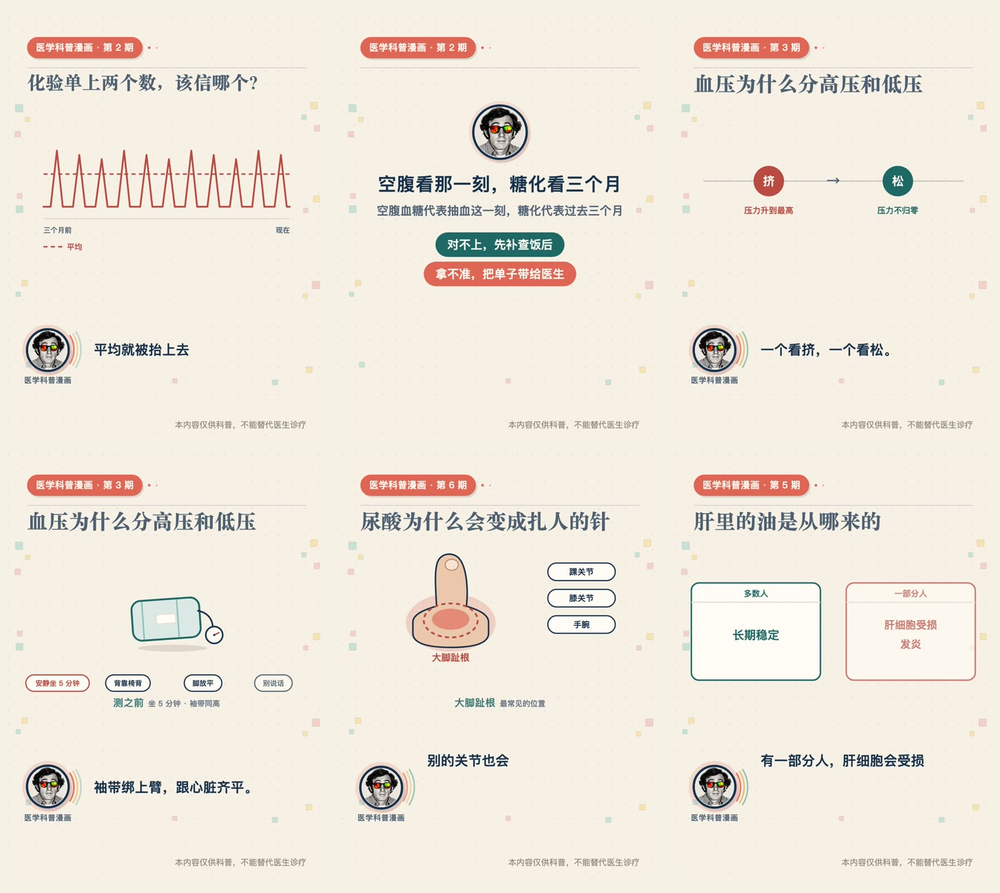
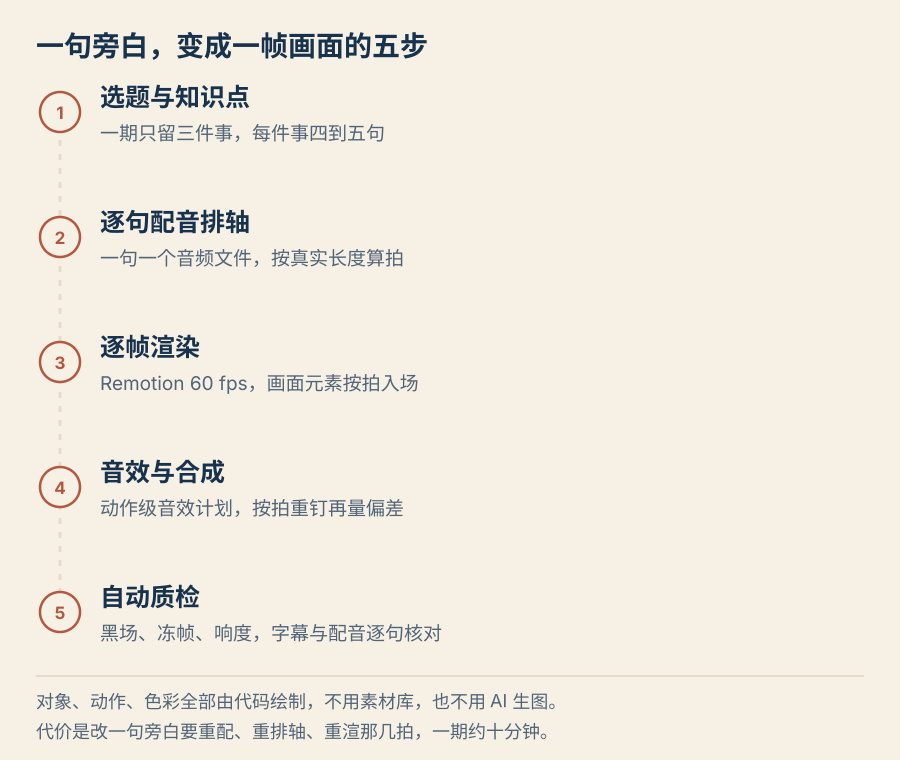

# 医学科普漫画：把一张化验单拍成一百秒的微缩片

化验单上两个数，一个正常、一个画着箭头，多数人不知道该信哪个。这个项目把每个选题做成 3:4 竖版、一百秒左右的剪纸微缩片：一期只讲三件事，画面里的对象自己把机制演出来，不用说明卡，也不用 AI 生图。

**微信公众号**：医学科普漫画 ｜ 已出片 7 期，单期 1 分 40 秒到 3 分 56 秒
**GitHub**：[trumanzhongqiang/medical-comic](https://github.com/trumanzhongqiang/medical-comic) ｜ 口径、拍点、逐句配音轨与渲染组件都在里面

## 成片

| 期 | 选题 | 时长 |
|---|---|---|
| 第 2 期 | 化验单上两个数，该信哪个 | 1:40 |
| 第 3 期 | 血压为什么分高压和低压 | 1:43 |
| 第 1 期 | 糖尿病，只是糖吃多了吗 | 1:56 |
| 第 6 期 | 尿酸为什么会变成扎人的针 | 2:11 |
| 第 4 期 | 血脂为什么分好和坏 | 2:36 |
| 第 5 期 | 肝里的油是从哪来的 | 2:47 |
| 第 7 期 | 甲亢和甲减 | 3:56 |

只有第 2、3 期是按下面这套写法做的，其余五期是早期版本，排在重做的队里。第 2 期原来是 3 分 57 秒，第 3 期原来是 2 分 52 秒——不是加速，是把知识点砍掉。

## 一句旁白怎么变成一帧画面

每句旁白单独生成一个音频文件，按真实长度排轴，再换算成拍；画面组件按拍切场景，元素在指定的起止时间入场；音效写成动作级的计划（第几拍、什么动作、多响），合成时按拍重钉一遍，再量一次实际偏差。

对象、动作、颜色全部是代码画的——剪纸层次靠同色系明暗和 3 到 8 像素的错位，没有素材库。代价是改一句旁白要重配、重排轴、重渲那几拍，一期大约十分钟。

## 写作比渲染难

真正返工六轮的是文案，不是技术。现在写之前先做三件事：

- **先列知识点，再动笔。** 一期只留三件，每件四到五句，每句五秒左右。三分钟的内容塞不进一分半，硬塞就会听不懂。
- **术语就地解释。** 说出「糖化」的同半句里就给一句大白话，不另开一拍补解释。
- **抽象名词解压成「谁做了什么」。** 「平均被抬上去」写成「把这些数加起来一平均，就上去了」。
- **不用要先建模型的比喻。** 说过一次「糖化是一本账」，观众得先理解账本、才能理解血糖——多一层解码，删掉。
- **先想好这条推导在画面上长什么样，再写那句旁白。** 平均值虚线、末端的虚线圈，都是先有画面才有句子的。

## 用脚本量出来的数

写完跑一遍文案体检（单句过密、句长节奏、抽象主语、术语未解释、多音字、量词口径）：

| | 第 2 期 | 第 3 期 |
|---|---|---|
| 句数 / 拍数 | 16 / 9 | 19 / 12 |
| 时长 | 1:40 | 1:43 |
| 体长均值 | 21.9 字 | 17.3 字 |
| 句长标准差 | 4.1 | 5.6 |
| 硬伤 | 1 条 | 0 条 |

标准差低于 5 就是「一条平线」：句句差不多长，十来句之后注意力自然掉。第 3 期有意插了八个字的短句落点。

## 踩过的坑

**配音缓存。** 改文案时工具遇到同名音频会跳过，结果字幕改了、声音还在念旧稿。现在改一句就先把旧文件挪走，交付前把整条旁白轨拼起来转写一遍逐句核对。

**帧序列命名。** 渲染输出 `element-00001.jpeg`，合成脚本只认 `frame_000001.jpg`，对不上就静默少一半帧，成片莫名变短。现在渲染完自动改名。

**动画起止。** 组件的时间参数第二项是结束点不是时长，写成 `(0.72, 0.14)` 会得到负的时长，元素永远不出现。

**响度。** 线性归一被真峰卡住时，标称 −14 LUFS 实际只有 −15.2。现在合成后实测，不够就按差值补。

## 没做完的

第 2 期还剩一句 31 个字、四个分句的长句没拆；第 1、4、5、6、7 期还没按这套写法重写。
