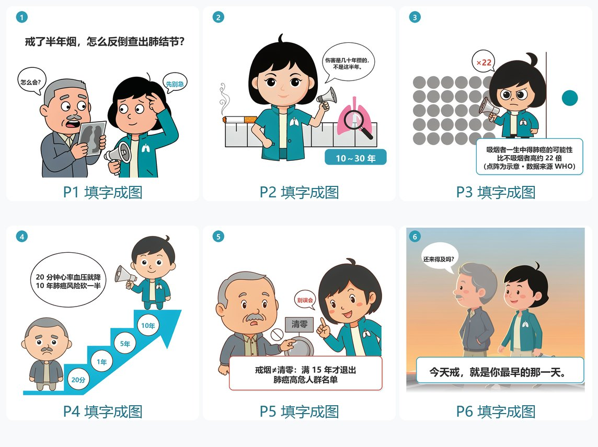

# Science Comic Skill: a topic becomes a strip you can actually open

Science posts lose readers, and most creators cannot draw. This Agent Skill is not one click. It checks facts, writes a storyboard, draws blank bubbles one panel at a time, then composites the Chinese text with a script.

**GitHub**: [trumanzhongqiang/science-comic-skill](https://github.com/trumanzhongqiang/science-comic-skill) ｜ v1.2.0 ｜ MIT

## A real run

This is an actual 6-panel strip from 2026-10-14, topic "quitting smoking", not a marketing mock.




Full images and the evaluation note live in [`examples/samples/lung-cancer-quit/`](https://github.com/trumanzhongqiang/science-comic-skill/tree/main/examples/samples/lung-cancer-quit). Open `preview.html` there.

| | This run |
|---|---|
| Generations | 11 calls, 6 usable panels, 45% waste |
| Waste | filename collision, parallel overwrite, body-proportion drift, a button drawn in the wrong state, too few badges |
| Text | the image model writes no Chinese. Long lines move to caption cards when the bubble is too small |
| Facts | 7 searches. When WHO and China CDC figures disagreed, one source was kept and the choice was written down |

The pictures were produced under v1.1.0 and were not redrawn after later rule changes.

## What it actually does

```
topic → fact check (conflicting sources must be resolved)
     → character card (style words plus concrete body proportions)
     → storyboard approval
     → one folder per panel, generated serially
     → script finds bubbles and sets type
     → a four-point delivery note
```

## Three rules that failed in testing

**Pasting the anchor prompt verbatim does not freeze the character.** "chibi 2-head-tall" alone still produced a tall body in panel 3 and a different skin tone in panel 5. The prompt now also requires a huge round head, a stubby body, and a hex skin color. Redraws strengthen that, instead of patching the old image.

**Five characters is not the writing limit.** It is how much text fits in the small bubble the model often draws. The prompt now asks for a large blank bubble and a spoken line a reader can understand. If it still does not fit at a readable size, use a caption card. Do not shrink the type until it is illegible.

**Text compositing is not "open an image editor".** It needs region detection, Chinese line-breaking rules, and a plan for the mandatory watermark in the corner. The scripts ship in `tools/`.
